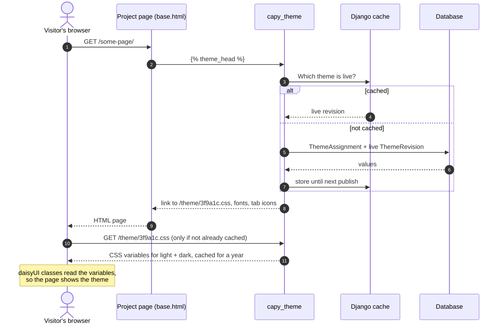
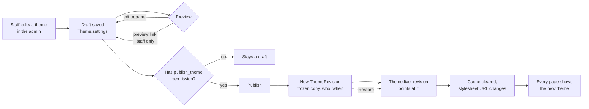
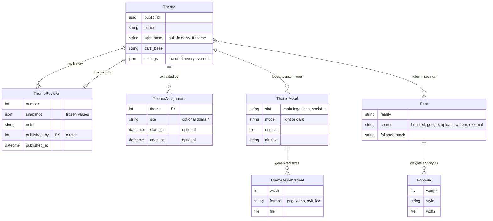

# capy-theme: Build Plan

capy-theme is a reusable Django app that lets whoever runs a site control its whole look from the admin: themes, colours, fonts, logos, icons and more, with no code changes or redeploys. It works in any Django project with a daisyUI 5 stylesheet, and gives the same branding to other front ends through a JSON API.

> **Revised before Phase 7 (2026-11-10):** the showcase page is replaced by a **Components** view in the live editor (new step 6.7). 7.1's API is hybrid: a plain Django view, or a DRF view documented automatically by drf-spectacular when the project uses DRF (`CAPY_THEME_API` overrides). 7.6 becomes a developer docs page in the repo. 8.4 becomes the Components view's final pass. The module was also reorganised into sections of small files (#150) and its data tables moved to JSON (#152).

> **Scope (after v0.5.0, 2026-11-10):** capy-theme handles every aspect of the theme but only applies it to the page's own look. Everything else it produces (logos for email and print, icons, the sharing image, colours, fonts) is **made available** to other modules through `capy_theme.artifacts.get_artifacts()`, `` and the JSON API (7.1). It doesn't serve a web app manifest, output link-preview tags or send email; the project or another module (e.g. an app shell) does that with the artifacts. 5.5 and the tags part of 5.6 were removed in #143.

> **Revised after v0.1.0 (2026-11-10):** the live theme editor moved up to Phase 3, straight after colours, and is now the main way to edit a theme's look (the admin form stays as a fallback). Fonts and images follow it and add their controls to it. 6.1 (light/dark toggle) was done early, in v0.1.0. Reasons are in `docs/DECISIONS.md`. GitHub issue numbers didn't change; their titles and milestones did.

The work is split into 9 phases and 66 small steps. Each step is one GitHub issue that changes a few files and ends with something you can see and check yourself. Each phase ends with a tagged release.

The module is built completely on its own, in its own repo, with a small demo site inside it for seeing it work. No other project is involved until one chooses to install a tagged version.

Full feature list: [capy-theme: Full Feature Spec](https://claude.ai/artifact/Ne5QdSRwcRwn82gmDLskEa)

## Contents

- [How to work through it](#how-to-work-through-it)
- [Setting up GitHub](#setting-up-github)
- [The demo site and the editor's Components view](#the-demo-site-and-the-editors-components-view)
- [How the module works](#how-the-module-works)
- [The phases](#the-phases)
- [Every step](#every-step)

## How to work through it

One issue at a time, in order, with a check before moving on.

1. On the project board, drag the next issue to **In progress**.
2. Give Claude Code the issue with the prompt below. It builds only that step and stops.
3. Read the changed files (`git diff`) and run the issue's **Check it** list yourself. Ask Claude Code to explain anything unclear before going on.
4. Commit with the issue number in the message, e.g. `Theme stylesheet (#5)`. Tick the boxes and close the issue; the card moves to **Done**.

Prompt for each issue (replace the number):

```text
Read GitHub issue #5 in Just-Sean/capy-theme (gh issue view 5), or the text I paste below.
The full plan is in docs/PLAN.md for context only.

Build only what this issue's "Build" list says. Don't start the next issue, and don't change
unrelated files. Write tests for what you add. Then run uv run pytest and uv run ruff check .,
fix any failures, and stop. Don't commit.

Finish with: the files you changed and why, and how I can see it working.
```

If a step turns out bigger than expected, split it into two issues rather than doing it all at once.

## Setting up GitHub

Each phase is a **milestone** (GitHub shows its progress as a bar), each step is an **issue** with a phase label, and a **project board** shows them as cards in columns.

**1. Create the issues.** Two ways:

- **Script:** `create-capy-theme-issues.sh` creates the 9 milestones, 10 labels and 64 issues in `Just-Sean/capy-theme`. It needs the GitHub CLI logged in (`gh auth login`) and skips anything that already exists, so it's safe to run twice.
- **By hand:** `capy-theme-issues.md` has every issue's title and description ready to paste. Create the milestones first (Issues > Milestones > New milestone), then each issue.

**2. Create the board.**

1. On github.com: your profile > **Projects** > **New project** > **Board**, named "capy-theme".
2. Columns: **Todo**, **In progress**, **In review**, **Done**.
3. In the project's **Workflows**, turn on **Auto-add to project** for `Just-Sean/capy-theme`, and **Item closed** (moves to Done).
4. Optional custom fields (project **Settings > Custom fields**): Purpose (single select: Feature, Task, Bug, Docs, Release), Sprint (iteration), Epic (single select, one per phase), Story Points (number).
5. Optional: group the board by **Milestone**, so each phase is its own section.

**3. Link commits to issues.** `#5` in a commit message links the commit to issue 5; `Closes #5` closes the issue when pushed to `main`.

## The demo site and the editor's Components view

Two places to see the module working, for different purposes:

| | Demo site | Components view |
| --- | --- | --- |
| What it is | A tiny Django site in the repo's `demo/` folder | A view inside the live editor showing every daisyUI component |
| Ships with the module? | No. Development only | Yes, as part of the editor |
| Purpose | Run the module while building it, and check it works on ordinary pages it doesn't own | Let theme editors see every component in the draft theme while they edit |
| Who sees it | You, locally | Staff who can edit themes |

Until v0.6 this was a separate showcase page (`/theme/showcase/`). It was replaced
because the editor already runs on the real page; step 6.7 moves the component
samples into the editor, and 8.4 is its final pass.

## How the module works

**1. Loading a page.** After the first page, the live theme comes from the cache and the browser already has the stylesheet, so the theme costs almost nothing per request.



**2. Editing and publishing.** Edits never reach visitors until someone with the publish permission publishes, and every publish can be undone.



**3. The data model.** Phase 1 creates `Theme`, `ThemeRevision` and `ThemeAssignment`, which fix the overall shape. The others arrive with their phases (fonts in Phase 3, images in Phase 4) as new tables, without changing the first three. Images are never edited in place, so an old revision always still shows its original logo.



## The phases

| Phase | Release | Steps | Done when |
| --- | --- | --- | --- |
| Phase 0: Setup | - | 3 | The empty module exists on GitHub, with its own demo site for seeing it work. No other project involved. |
| Phase 1: Foundation | v0.1.0 ✅ | 10 + 6.1 | Themes exist, one is live, and every page uses it. Publish, history and permissions work. Visitors can switch light/dark. |
| Phase 2: Colours and shape | v0.2.0 | 8 | The engine: every colour and shape value can be overridden, stored and published, with readable text guaranteed. Plain admin fields. |
| Phase 3: Live theme editor | v0.3.0 | 9 | Edit a theme on the real page and see every change instantly, then save the draft or publish it. The main way to edit. |
| Phase 4: Fonts | v0.4.0 | 9 | Fonts for every role from every source, all self-hosted, chosen in the live editor. |
| Phase 5: Images and icons | v0.5.0 | 9 | Every logo slot, icon and sharing image, generated from single uploads, with controls in the live editor. |
| Phase 6: Visitors and scheduling | v0.6.0 | 5 | Visitors can choose the theme (if allowed); themes can be scheduled. |
| Phase 7: Portability and API | v0.7.0 | 7 | Themes move between sites, and other front ends can read them. |
| Phase 8: Advanced and 1.0 | v1.0.0 | 6 | The advanced options, then a proven, documented 1.0. |

## Every step

Full descriptions (goal, build list, checks) are in the GitHub issues. The issue number is in brackets.

### Phase 0: Setup (-)

- [x] **0.1 Create capy-theme from the module template** (#1)
- [x] **0.2 Demo site inside the module** (#2)
- [x] **0.3 Tailwind, daisyUI and a sample page in the demo site** (#3)

### Phase 1: Foundation (v0.1.0) ✅

- [x] **1.1 Built-in theme catalogue** (#4)
- [x] **1.2 Theme model** (#5)
- [x] **1.3 Revisions and publishing** (#6)
- [x] **1.4 Active theme selection** (#7)
- [x] **1.5 Theme stylesheet** (#8)
- [x] **1.6  tag and theme context** (#9)
- [x] **1.7 Site name, tagline and main logo** (#10)
- [x] **1.8 Theme showcase page** (#11)
- [x] **1.9 Permissions** (#12)
- [x] **1.10 Release v0.1.0** (#13)
- [x] **6.1 Mode settings and toggle** (#46), brought forward
- [x] Extras found along the way: base-change notice (#78), decision log (#82), stylesheet version in URLs (#86), demo fixes (#90, #91)

### Phase 2: Colours and shape, the engine (v0.2.0)

- [ ] **2.1 Colour overrides** (#14): Override any of the 20 colours, separately for light and dark.
- [ ] **2.2 Colour input** (#15): Enter colours any common way, stored as OKLCH. Plain admin fields.
- [ ] **2.3 Automatic text colours and background shades** (#16): Text is always readable on any colour chosen.
- [ ] **2.4 Contrast warnings** (#17): WCAG ratings calculated on the server, shown in the admin and on the showcase.
- [ ] **2.6 Shape and effects** (#19): daisyUI's shape settings.
- [ ] **2.7 Browser colour, focus colour and email colours** (#20): Colour details outside the page itself.
- [ ] **2.8 Showcase: colours and shape** (#21): See every colour and shape setting on the showcase.
- [ ] **2.9 Release v0.2.0** (#22)

(2.5 Palette suggestions moved to the editor as 3.4.)

### Phase 3: Live theme editor (v0.3.0)

- [ ] **3.1 Editor on the showcase** (#42): An Edit theme panel on the showcase, for that user only.
- [ ] **3.2 Draft preview endpoint** (#96): The server works out text colours and contrast for unsaved values, with the same code as publishing. Nothing is stored.
- [ ] **3.3 Colour and shape controls** (#97): Pickers and sliders with an instant preview and contrast badges.
- [ ] **3.4 Palette suggestions** (#18): From the primary colour or the logo.
- [ ] **3.5 Save draft and publish from the editor** (#98): Through the existing permissions and revisions.
- [ ] **3.6 Edit on any page** (#43): The editor on any page that uses ``.
- [ ] **3.7 History: compare and restore** (#44): Undo with confidence.
- [ ] **3.8 Admin form tidy-up** (#41): The admin form as a tidy fallback, with an "Edit live" link.
- [ ] **3.9 Release v0.3.0** (#45)

### Phase 4: Fonts (v0.4.0)

- [ ] **4.1 Font library and roles** (#23): Fonts stored once and used by any theme; role pickers in the editor.
- [ ] **4.2 System font stacks** (#24): The fastest option: the device's own fonts.
- [ ] **4.3 Curated font collection** (#25): About 30 good fonts ready to pick.
- [ ] **4.4 Font uploads** (#26): Use any font file.
- [ ] **4.5 Google Fonts import** (#27): Any Google font, hosted locally.
- [ ] **4.6 External font stylesheets** (#28): Licensed fonts that can't be self-hosted (e.g. Adobe Fonts).
- [ ] **4.7 Type scale and font loading** (#29): Sizes and loading behaviour.
- [ ] **4.8 Showcase: typography** (#30): See every font and type setting on the showcase.
- [ ] **4.9 Release v0.4.0** (#31)

### Phase 5: Images and icons (v0.5.0)

- [x] **5.1 Safe image uploads** (#32): Uploads can't carry attacks or leak data.
- [x] **5.2 SVG cleaning** (#33): SVG logos without the security risk.
- [x] **5.3 Logo slots and responsive images** (#34): The right logo, at the right size, everywhere.
- [x] **5.4 Icons and favicons** (#35): Every icon from one square image.
- [x] **5.5 Web app manifest** (#36): built, then removed in #143 (out of scope; the icons a manifest needs are artifacts).
- [x] **5.6 Social sharing image and tags** (#37): the 1200 × 630 image stays as an artifact; the tags were removed in #143.
- [x] **5.7 Background images** (#38): Optional decorative images.
- [x] **5.8 Showcase: images and icons** (#39): See every image the theme produces on the showcase.
- [x] **5.9 Release v0.5.0** (#40)
- [x] **Scope: expose artifacts, don't apply them** (#143): `get_artifacts()`, manifest and tags removed.

### Phase 6: Visitors and scheduling (v0.6.0)

- [x] **6.1 Mode settings and toggle** (#46): done in v0.1.0.
- [x] **6.2 Visitor theme picker** (#47): Visitors choose among themes the operator allows.
- [x] **6.3 Scheduling** (#48): Themes that go live and end on given dates.
- [x] **6.4 Device accessibility preferences** (#49): Respect visitors' system settings.
- [x] **6.5 Showcase: mode and visitor choices** (#50): Try the visitor-facing controls on the showcase.
- [x] **6.6 Release v0.6.0** (#51)
- [x] **Reorganise into small sections** (#150) and **data tables to JSON** (#152)
- [x] **6.7 Components view in the editor** (#155): Replace the showcase page with every daisyUI component inside the live editor.
- [x] **6.8 See it as a visitor** (#158): Admins see what visitors see (published theme, by mode, offered theme or date), a visitors summary, and the images and icons in the Components view.

### Phase 7: Portability and API (v0.7.0)

- [x] **7.1 JSON API** (#52): Front ends, mobile apps and other modules get the branding (the same data as `get_artifacts()`). A plain Django view, or a DRF view that drf-spectacular documents automatically when the project uses DRF (`CAPY_THEME_API` = auto / drf / django).
- [x] **7.2 Design tokens export** (#53): Theme values for design tools and native app builds.
- [x] **7.3 Theme export and import** (#54): Move a theme between sites.
- [x] **7.4 daisyUI theme block export** (#55): For projects that want the theme compiled into their stylesheet.
- [x] **7.5 Management commands** (#56): Scripted installs and maintenance.
- [x] **7.6 Developer docs page** (#57): `docs/developers.md`: every CSS variable, the API and how to read it, the downloads, the API-mode and CORS notes.
- [x] **7.7 Release v0.7.0** (#58)

### Phase 8: Advanced and 1.0 (v1.0.0)

- [ ] **8.1 Custom CSS** (#59): An escape hatch for anything the settings don't cover.
- [ ] **8.2 Multiple sites** (#60): One install serving several domains, each with its own theme.
- [ ] **8.3 Project settings** (#61): Projects can set limits.
- [ ] **8.4 Editor Components view: final pass** (#62): Every editor setting changes something visible in the Components view; accessibility check in both modes.
- [ ] **8.5 Prove it works in a real project** (#63): Confirm the module is truly pluggable.
- [ ] **8.6 Release v1.0.0** (#64): The first stable version.
