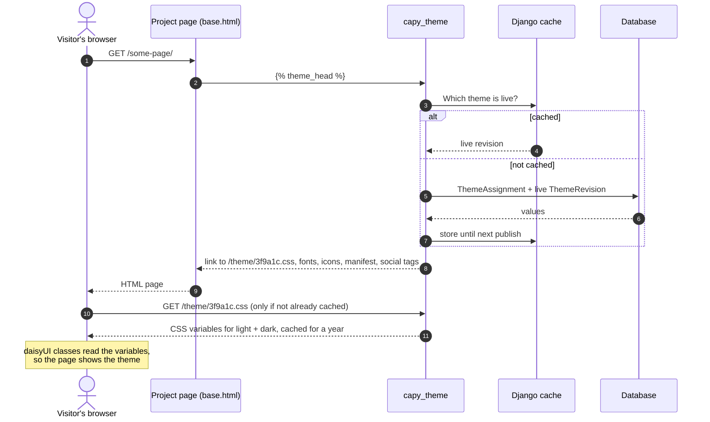
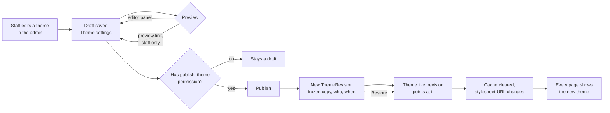
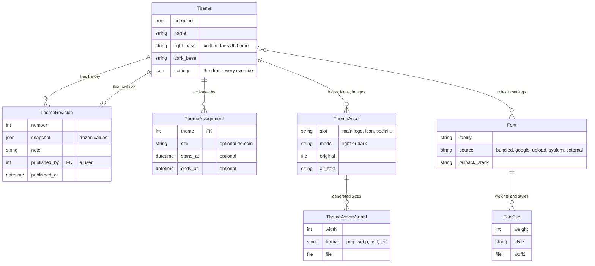

# capy-theme: Build Plan

capy-theme is a reusable Django app that lets whoever runs a site control its whole look from the admin: themes, colours, fonts, logos, icons and more, with no code changes or redeploys. It works in any Django project with a daisyUI 5 stylesheet, and gives the same branding to other front ends through a JSON API.

The work is split into 9 phases and 64 small steps. Each step is one GitHub issue that changes a few files and ends with something you can see and check yourself. Each phase ends with a tagged release.

The module is built completely on its own, in its own repo, with a small demo site inside it for seeing it work. No other project is involved until one chooses to install a tagged version.

Full feature list: [capy-theme: Full Feature Spec](https://claude.ai/artifact/Ne5QdSRwcRwn82gmDLskEa)

## Contents

- [How to work through it](#how-to-work-through-it)
- [Setting up GitHub](#setting-up-github)
- [The demo site and the showcase page](#the-demo-site-and-the-showcase-page)
- [How the module works](#how-the-module-works)
- [The phases](#the-phases)
- [Every step](#every-step)

## How to work through it

One issue at a time, in order, with a check before moving on.

1. On the project board, drag the next issue to **In progress**.
2. Give Claude Code the issue with the prompt below. It builds only that step and stops.
3. Read the changed files (`git diff`) and run the issue's **Check it** list yourself. Ask Claude Code to explain anything unclear before going on.
4. Commit with the issue number in the message, e.g. `Theme stylesheet (#5)`. Tick the boxes and close the issue; the card moves to **Done**.

Prompt for each issue (replace the number):

```text
Read GitHub issue #5 in Just-Sean/capy-theme (gh issue view 5), or the text I paste below.
The full plan is in docs/PLAN.md for context only.

Build only what this issue's "Build" list says. Don't start the next issue, and don't change
unrelated files. Write tests for what you add. Then run uv run pytest and uv run ruff check .,
fix any failures, and stop. Don't commit.

Finish with: the files you changed and why, and how I can see it working.
```

If a step turns out bigger than expected, split it into two issues rather than doing it all at once.

## Setting up GitHub

Each phase is a **milestone** (GitHub shows its progress as a bar), each step is an **issue** with a phase label, and a **project board** shows them as cards in columns.

**1. Create the issues.** Two ways:

- **Script:** `create-capy-theme-issues.sh` creates the 9 milestones, 10 labels and 64 issues in `Just-Sean/capy-theme`. It needs the GitHub CLI logged in (`gh auth login`) and skips anything that already exists, so it's safe to run twice.
- **By hand:** `capy-theme-issues.md` has every issue's title and description ready to paste. Create the milestones first (Issues > Milestones > New milestone), then each issue.

**2. Create the board.**

1. On github.com: your profile > **Projects** > **New project** > **Board**, named "capy-theme".
2. Columns: **Todo**, **In progress**, **In review**, **Done**.
3. In the project's **Workflows**, turn on **Auto-add to project** for `Just-Sean/capy-theme`, and **Item closed** (moves to Done).
4. Optional custom fields (project **Settings > Custom fields**): Purpose (single select: Feature, Task, Bug, Docs, Release), Sprint (iteration), Epic (single select, one per phase), Story Points (number).
5. Optional: group the board by **Milestone**, so each phase is its own section.

**3. Link commits to issues.** `#5` in a commit message links the commit to issue 5; `Closes #5` closes the issue when pushed to `main`.

## The demo site and the showcase page

Two places to see the module working, for different purposes:

| | Demo site | Showcase page |
| --- | --- | --- |
| What it is | A tiny Django site in the repo's `demo/` folder | A page the module itself provides, at `/theme/showcase/` |
| Ships with the module? | No. Development only | Yes. Every project that installs the module gets it |
| Purpose | Run the module while building it, and check it works on ordinary pages it doesn't own | Let operators and designers see every theme choice in action |
| Who sees it | You, locally | Staff by default; can be made public or turned off (`CAPY_THEME_SHOWCASE`) |

The showcase page uses lorem ipsum text and grows with every phase, so each feature is visible as soon as it exists:

- **1.8 Theme showcase page:** One page where anyone allowed can see every theme choice in action. Later phases add their sections to it.
- **2.8 Showcase: colours and shape:** See every colour and shape setting on the showcase.
- **3.8 Showcase: typography:** See every font and type setting on the showcase.
- **4.8 Showcase: images and icons:** See every image the theme produces on the showcase.
- **6.5 Showcase: mode and visitor choices:** Try the visitor-facing controls on the showcase.
- **7.6 Showcase: developer section:** Everything a front-end developer needs, on one page.
- **8.4 Showcase: final pass:** The showcase shows every choice in the spec.

By 1.0 it shows the logos in every slot and mode, every icon, every font role and weight, all 20 colours with contrast ratings, the shape settings, the light/dark switch and theme picker, the social preview, and every CSS variable, in light and dark side by side.

## How the module works

**1. Loading a page.** After the first page, the live theme comes from the cache and the browser already has the stylesheet, so the theme costs almost nothing per request.



**2. Editing and publishing.** Edits never reach visitors until someone with the publish permission publishes, and every publish can be undone.



**3. The data model.** Phase 1 creates `Theme`, `ThemeRevision` and `ThemeAssignment`, which fix the overall shape. The others arrive with their phases (fonts in Phase 3, images in Phase 4) as new tables, without changing the first three. Images are never edited in place, so an old revision always still shows its original logo.



## The phases

| Phase | Release | Steps | Done when |
| --- | --- | --- | --- |
| Phase 0: Setup | - | 3 | The empty module exists on GitHub, with its own demo site for seeing it work. No other project involved. |
| Phase 1: Foundation | v0.1.0 | 10 | Themes exist, one is live, and every page uses it. Publish, history and permissions work. |
| Phase 2: Colours and shape | v0.2.0 | 9 | Every colour and shape value can be overridden, with readable text guaranteed. |
| Phase 3: Fonts | v0.3.0 | 9 | Fonts for every role from every source, all self-hosted. |
| Phase 4: Images and icons | v0.4.0 | 9 | Every logo slot, icon and sharing image, generated from single uploads. |
| Phase 5: Theme editor | v0.5.0 | 5 | A purpose-built editor with live preview, instead of a long form. |
| Phase 6: Visitors and scheduling | v0.6.0 | 6 | Visitors control light/dark (and optionally the theme); themes can be scheduled. |
| Phase 7: Portability and API | v0.7.0 | 7 | Themes move between sites, and other front ends can read them. |
| Phase 8: Advanced and 1.0 | v1.0.0 | 6 | The advanced options, then a proven, documented 1.0. |

## Every step

Full descriptions (goal, build list, checks) are in the GitHub issues and `capy-theme-issues.md`.

### Phase 0: Setup (-)

- [ ] **0.1 Create capy-theme from the module template:** An empty, installable module with passing tests, on GitHub.
- [ ] **0.2 Demo site inside the module:** A tiny Django site in the module's own repo, for running and clicking through the module while it's built.
- [ ] **0.3 Tailwind, daisyUI and a sample page in the demo site:** A normal project-style page in the demo site, to check the theme works on pages the module doesn't own.

### Phase 1: Foundation (v0.1.0)

- [ ] **1.1 Built-in theme catalogue:** The module knows all 35 daisyUI themes and their values.
- [ ] **1.2 Theme model:** Saved themes in the database: the core shape every later phase builds on.
- [ ] **1.3 Revisions and publishing:** Drafts are separate from what's live, and every publish is kept.
- [ ] **1.4 Active theme selection:** The site knows which theme is live.
- [ ] **1.5 Theme stylesheet:** The live theme served as CSS that browsers cache.
- [ ] **1.6  tag and theme context:** Pages pick up the theme.
- [ ] **1.7 Site name, tagline and main logo:** The basics of branding.
- [ ] **1.8 Theme showcase page:** One page where anyone allowed can see every theme choice in action. Later phases add their sections to it.
- [ ] **1.9 Permissions:** Only the right staff can publish.
- [ ] **1.10 Release v0.1.0:** A tagged, tested foundation.

### Phase 2: Colours and shape (v0.2.0)

- [ ] **2.1 Colour overrides:** Override any of the 20 colours, separately for light and dark.
- [ ] **2.2 Colour input:** Enter colours any common way.
- [ ] **2.3 Automatic text colours and background shades:** Text is always readable on any colour chosen.
- [ ] **2.4 Contrast warnings:** The operator sees when colours are hard to read.
- [ ] **2.5 Palette suggestions:** Help choosing colours that go together.
- [ ] **2.6 Shape and effects:** daisyUI's shape settings.
- [ ] **2.7 Browser colour, focus colour and email colours:** Colour details outside the page itself.
- [ ] **2.8 Showcase: colours and shape:** See every colour and shape setting on the showcase.
- [ ] **2.9 Release v0.2.0:** Tagged and tested.

### Phase 3: Fonts (v0.3.0)

- [ ] **3.1 Font library and roles:** Fonts stored once and used by any theme.
- [ ] **3.2 System font stacks:** The fastest option: the device's own fonts.
- [ ] **3.3 Curated font collection:** About 30 good fonts ready to pick.
- [ ] **3.4 Font uploads:** Use any font file.
- [ ] **3.5 Google Fonts import:** Any Google font, hosted locally.
- [ ] **3.6 External font stylesheets:** Licensed fonts that can't be self-hosted (e.g. Adobe Fonts).
- [ ] **3.7 Type scale and font loading:** Sizes and loading behaviour.
- [ ] **3.8 Showcase: typography:** See every font and type setting on the showcase.
- [ ] **3.9 Release v0.3.0:** Tagged and tested.

### Phase 4: Images and icons (v0.4.0)

- [ ] **4.1 Safe image uploads:** Uploads can't carry attacks or leak data.
- [ ] **4.2 SVG cleaning:** SVG logos without the security risk.
- [ ] **4.3 Logo slots and responsive images:** The right logo, at the right size, everywhere.
- [ ] **4.4 Icons and favicons:** Every icon from one square image.
- [ ] **4.5 Web app manifest:** The site can be installed as an app.
- [ ] **4.6 Social sharing image and tags:** Good-looking link previews.
- [ ] **4.7 Background images:** Optional decorative images.
- [ ] **4.8 Showcase: images and icons:** See every image the theme produces on the showcase.
- [ ] **4.9 Release v0.4.0:** Tagged and tested.

### Phase 5: Theme editor (v0.5.0)

- [ ] **5.1 Editor layout:** A tidy editor page.
- [ ] **5.2 Live preview panel:** See changes before saving.
- [ ] **5.3 Preview on the real site:** Check a draft on real pages.
- [ ] **5.4 History: compare and restore:** Undo with confidence.
- [ ] **5.5 Release v0.5.0:** Tagged and tested.

### Phase 6: Visitors and scheduling (v0.6.0)

- [ ] **6.1 Mode settings and toggle:** Light, dark or follow the device, without a flash.
- [ ] **6.2 Visitor theme picker:** Visitors choose among themes the operator allows.
- [ ] **6.3 Scheduling:** Themes that go live and end on given dates.
- [ ] **6.4 Device accessibility preferences:** Respect visitors' system settings.
- [ ] **6.5 Showcase: mode and visitor choices:** Try the visitor-facing controls on the showcase.
- [ ] **6.6 Release v0.6.0:** Tagged and tested.

### Phase 7: Portability and API (v0.7.0)

- [ ] **7.1 JSON API:** Front ends and mobile apps get the branding.
- [ ] **7.2 Design tokens export:** Theme values for design tools and native app builds.
- [ ] **7.3 Theme export and import:** Move a theme between sites.
- [ ] **7.4 daisyUI theme block export:** For projects that want the theme compiled into their stylesheet.
- [ ] **7.5 Management commands:** Scripted installs and maintenance.
- [ ] **7.6 Showcase: developer section:** Everything a front-end developer needs, on one page.
- [ ] **7.7 Release v0.7.0:** Tagged and tested.

### Phase 8: Advanced and 1.0 (v1.0.0)

- [ ] **8.1 Custom CSS:** An escape hatch for anything the settings don't cover.
- [ ] **8.2 Multiple sites:** One install serving several domains, each with its own theme.
- [ ] **8.3 Project settings:** Projects can set limits.
- [ ] **8.4 Showcase: final pass:** The showcase shows every choice in the spec.
- [ ] **8.5 Prove it works in a real project:** Confirm the module is truly pluggable.
- [ ] **8.6 Release v1.0.0:** The first stable version.
